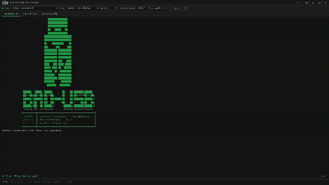

<div align="center">
  
  <br/><br/>
  
</div>

<br/>

> A web-based payload manager for **ATtiny85 / Digispark** HID keyboard emulators.
> Build, configure, and flash keystroke injection payloads through a terminal-style UI — no Arduino IDE required.

---

## What it does

- Type a command, pick a trigger and binary wrapper, hit Enter — compiles and flashes automatically
- Built-in preset library: recon, reverse shells, persistence, privilege escalation, exfil, and misc
- VID/PID spoofing — enumerate as Logitech, Dell, HP, Lenovo, Cherry, SanDisk, or a custom ID
- Adjustable per-character typing speed (0 ms → 1000 ms)
- Raw sketch mode — write DigiKeyboard.h code directly and upload it
- Registry shortcut — write Windows registry entries without typing the full PowerShell command
- Dark / light theme, command history, `.ino` preview before flashing

---

## Requirements

- [Node.js](https://nodejs.org) 18+
- `arduino-cli.exe` — placed in `tools/`
- `micronucleus.exe` — placed in `tools/`
- ATtiny85 / Digispark board

---

## Setup

**1. Get the tools**

Download both binaries and drop them into the `tools/` folder.

**arduino-cli.exe** — from the [official Arduino CLI releases](https://github.com/arduino/arduino-cli/releases):
```powershell
Invoke-WebRequest -UseBasicParsing "https://downloads.arduino.cc/arduino-cli/arduino-cli_latest_Windows_64bit.zip" -OutFile tmp.zip
Expand-Archive tmp.zip tools\ -Force
Remove-Item tmp.zip
```

**micronucleus.exe** — from the [micronucleus releases page](https://github.com/micronucleus/micronucleus/releases), grab the Windows `.exe` and rename it to `micronucleus.exe`:
```powershell
Invoke-WebRequest -UseBasicParsing "https://github.com/micronucleus/micronucleus/releases/download/2.6/micronucleus-2.6-win.exe" -OutFile tools\micronucleus.exe
```

After this your `tools/` folder should look like:
```
tools/
  arduino-cli.exe
  micronucleus.exe
```

**2. Clone and install dependencies**

```bash
git clone https://github.com/XBrutalPandaX/attiny-payload-manager
cd attiny-payload-manager
npm install
```

**3. Start the server and UI**

```bash
# terminal 1 — backend
node server.js

# terminal 2 — frontend (dev)
npm start
```

Open `http://localhost:3000` in your browser.

> For production: `npm run build` then `NODE_ENV=production node server.js` — serves everything on port 5000.

---

## Usage

1. **Pick a binary wrapper** (`bin:`) — how the command is launched on the target
   `powershell`, `powershell -bypass`, `powershell -hidden`, `cmd`, `certutil`, `mshta`, or custom

2. **Pick a trigger** (`via:`) — how the window opens on the target machine
   `win+r`, `win+s`, `win+e`, `win+x`, `ctrl+shift+esc`

3. **Set typing speed** (`speed:`) — milliseconds delay per character
   `0` = ATtiny85 maximum · `1000` = 1 character per second

4. **Optionally spoof VID/PID** (`usb:`) — makes the device enumerate as a known keyboard brand

5. **Type your command** and press Enter (or load a preset from the `presets.cfg` tab)

6. **Plug in the Digispark** when prompted — micronucleus waits for the device

---

## Presets

| Category | Payloads |
|---|---|
| `recon` | whoami/net, systeminfo dump, wifi passwords, process list |
| `shell` | PowerShell reverse shell, download-and-execute, certutil download |
| `persist` | HKCU run key, scheduled task (30 min), startup folder drop |
| `priv` | Disable Windows Defender, add local admin, enable RDP |
| `exfil` | Clipboard grab, browser credential paths, wifi profile export |
| `misc` | Open notepad, sleep test, popup, write desktop file, beep 3× |

---

## Project structure

```
attiny-payload-manager/
├── server.js          # Express + Socket.io backend, compile/upload logic
├── src/
│   ├── App.js         # React UI
│   └── App.css        # Terminal theme (dark + light)
├── tools/             # place arduino-cli.exe + micronucleus.exe here (not committed)
├── public/
│   ├── logo-dark.svg
│   ├── logo-light.svg
│   └── favicon.svg
└── docs/
    └── demo.gif
```

---

## Notes

- The Digispark **must** be plugged in AFTER the flash prompt appears — not before
- VID/PID spoofing patches the DigiKeyboard library's `usbconfig.h` before compile and restores it after
- Apple (`0x05AC`) and Microsoft (`0x045E`) VIDs are excluded — they conflict with OEM drivers on Windows
- For educational and authorized penetration testing use only